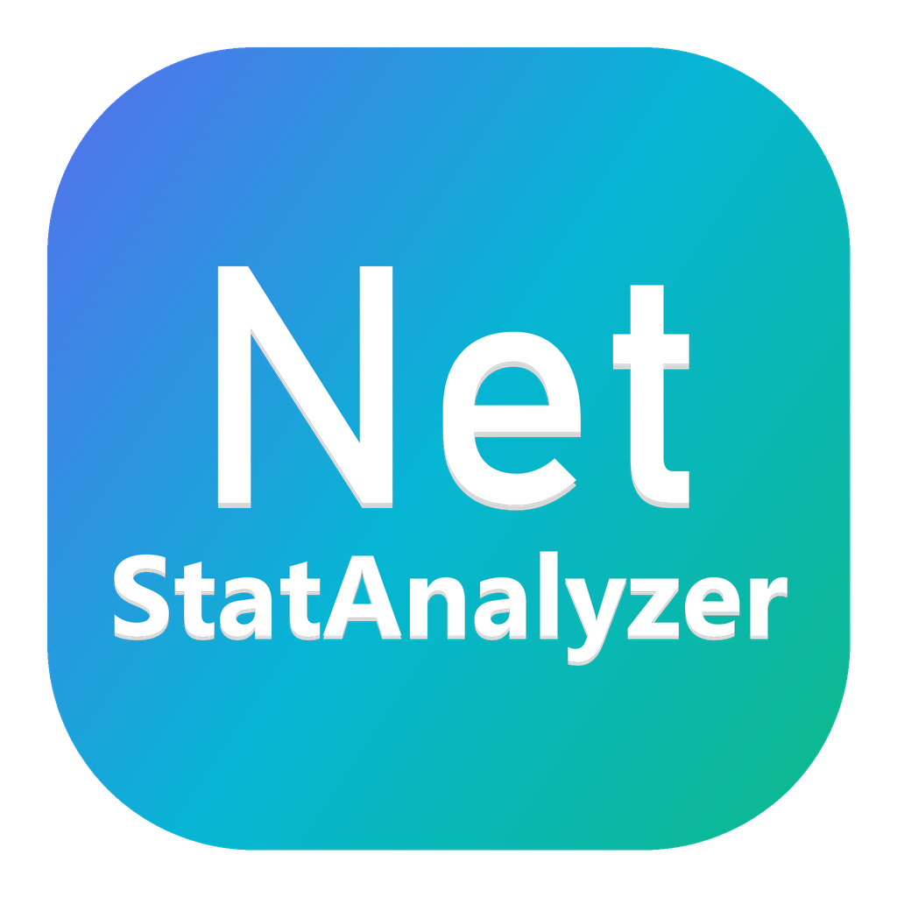
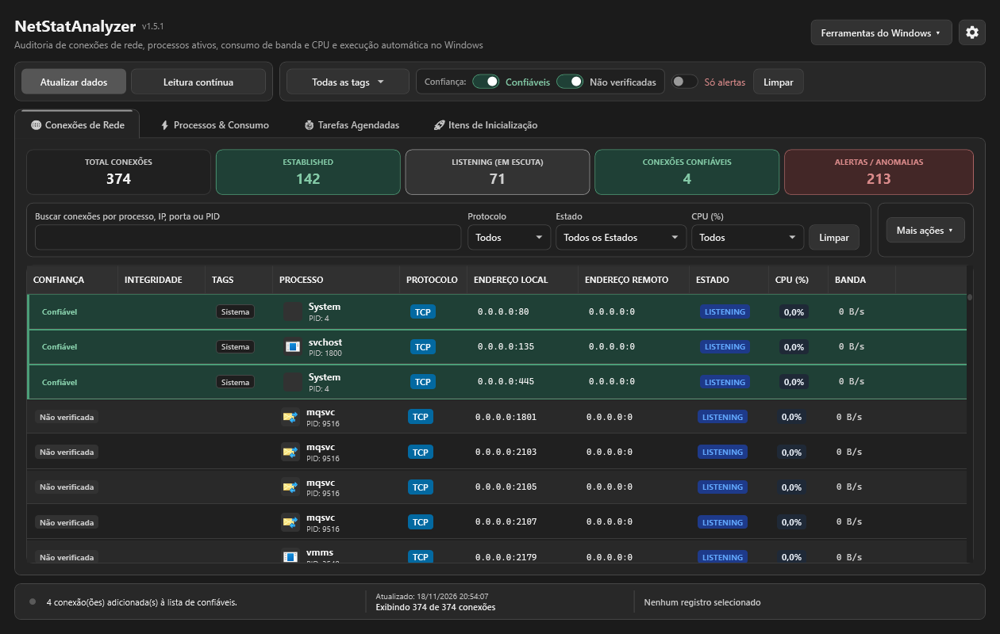
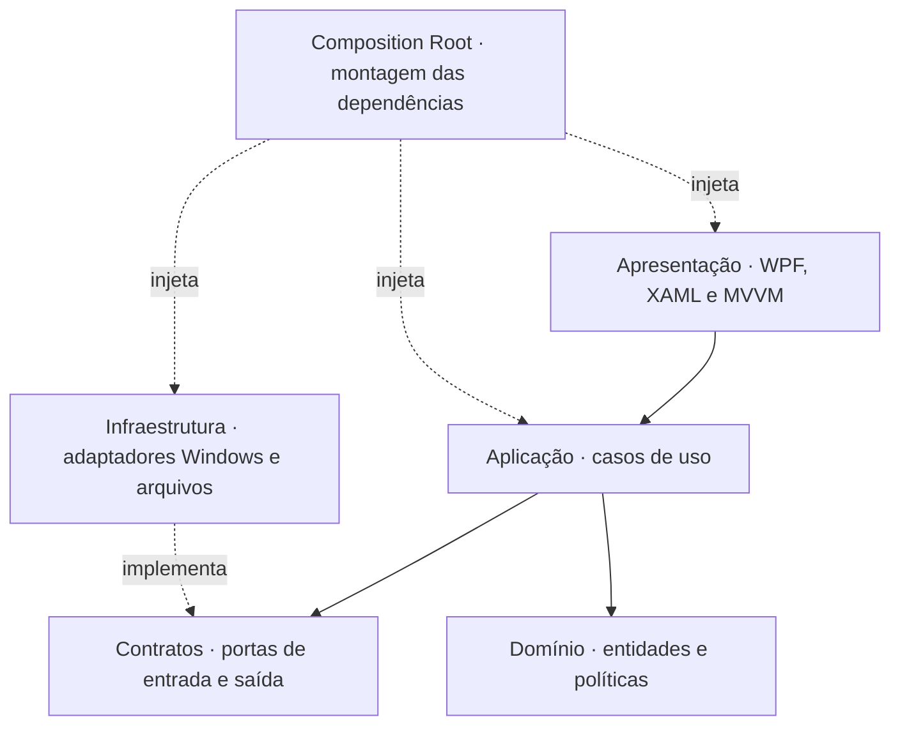

<h1 align="center">
  
  NetStatAnalyzer
</h1>

  Conexões TCP/UDP, portas em escuta e processos do Windows em uma interface desktop.

  <strong><a href="https://github.com/muriloai/NetStatAnalyzer/releases">Baixar para Windows</a></strong>
  · <a href="docs/desenvolvimento.md">Compilar a partir do código</a>

Windows 10 (versão 2004, build 19041 ou posterior) ou Windows 11, em x64. Para usar o pacote portátil autocontido, extraia o ZIP e abra `NetStatAnalyzer.exe`.

## O que você pode consultar?

- **Conexões TCP/UDP.** Veja endereços, portas e estados de conexão e identifique o processo pelo PID.
- **Processos.** Consulte a quantidade de conexões, o uso de CPU e as taxas de leitura e escrita por processo.
- **Tarefas agendadas e itens de inicialização.** Veja o que está configurado para rodar automaticamente e confira os comandos e arquivos associados.
- **Triagem local.** Filtre os dados por tag, confiança ou alerta e exporte os registros exibidos em JSON.

A coleta usa amostras do Windows, então conexões muito breves podem passar entre leituras. As taxas de leitura e escrita vêm dos contadores de I/O do processo e podem incluir operações de disco. Os alertas seguem regras locais e servem como pistas para investigação.

## Tecnologias | 

- **Aplicação desktop:** C#, .NET 8, WPF e XAML.
- **Integração com o Windows:** `netstat.exe`, `schtasks.exe`, `System.Diagnostics.Process`, APIs Win32 via P/Invoke e Registro do Windows.
- **Persistência e exportação:** `System.Text.Json` e arquivos JSON locais para regras, anotações, preferências e relatórios.
- **Testes e CI:** xUnit e GitHub Actions. O workflow restaura, compila e executa os testes em Windows com .NET 8.
- **Distribuição:** publicação autocontida em arquivo único para Windows x64, com o runtime .NET incluído.
- **Qualidade do código:** tipos de referência anuláveis habilitados nos projetos da solução.

## Arquitetura e padrões

O código é organizado em camadas inspiradas em **Clean Architecture**, sendo assim, o domínio permanece independente de WPF e das integrações com o sistema operacional. A aplicação concentra casos de uso e contratos, enquanto a infraestrutura implementa esses contratos com adaptadores para Windows e arquivos.

[Navegue por este diagrama em tela cheia](https://dataxstudios.com.br/br/apps/markdown-studio/#c=hZHBSgNBDIbvPkXYs-0jCGWLIFgooq2w9BBmUp2yMxknWftAHgRhz97dF5OZbrHWg7dJ-P9_viTblvfmGZPC_fwCAGCZSCgoquPQVLM4lsP78Mbw9Qnr5fUlPM4Wt0CwWK0W1QYmkyt4EKpRSLKldeZHb1BYwBJ0wtWmfHHUFmPNQRMalaY6PJUl-yInxWKk3LUIBIJDb3FMuQnbhKKpM9olaqpSU25olzBHoMWoaDmRwNoFy3sBAkwvnXtlyeBTcD625POEMD2l-Qs6Z48uNNWc_dAHV4ajoM6ipZwbuR16dQZlBKzZRxZ3WORJAXfMmt2eg-ITebBl0EjBDh_BODyyhR2NXKdXOQ8_kx6h_5H9Xt83&theme=default)

| Padrão/Prática | Local de uso |
| --- | --- |
| **MVVM** | Views em WPF/XAML usam ViewModels e data binding para separar interface e estado da aplicação. Veja [MainViewModel](Presentation/ViewModels/MainViewModel.cs) e [ViewModelBase](Presentation/Common/ViewModelBase.cs). |
| **Use Cases** | Operações como leitura de conexões, métricas, tarefas agendadas e regras de confiança ficam em classes próprias, como [ScanConnectionsUseCase](Application/UseCases/ScanConnectionsUseCase.cs). |
| **Ports and Adapters (Hexagonal)** | Contratos como [INetworkScanner](Application/Contracts/INetworkScanner.cs) e [IProcessResolver](Application/Contracts/IProcessResolver.cs) ficam na aplicação. [NetStatCliScanner](Infrastructure/Scanning/NetStatCliScanner.cs) e [Win32ProcessResolver](Infrastructure/Processes/Win32ProcessResolver.cs) implementam esses contratos na infraestrutura. |
| **Repository** | [JsonFileAllowlistRepository](Infrastructure/Persistence/JsonFileAllowlistRepository.cs) encapsula a leitura e gravação local de regras e anotações. |
| **Policy Objects de domínio** | [TrustEvaluationPolicy](Domain/Policies/TrustEvaluationPolicy.cs) e [ThreatDetectionPolicy](Domain/Policies/ThreatDetectionPolicy.cs) concentram decisões de confiança e classificação de alertas. |
| **Command** | [RelayCommand](Presentation/Common/RelayCommand.cs) e [AsyncRelayCommand](Presentation/Common/AsyncRelayCommand.cs) conectam ações síncronas e assíncronas aos comandos do WPF. |
| **Composition Root e injeção por construtor** | [ApplicationCompositionRoot](ApplicationCompositionRoot.cs) monta adaptadores e casos de uso e entrega suas dependências pelos construtores. |

Os contratos permitem testar os casos de uso com dependências simuladas, com isso, a [suíte xUnit](NetStatAnalyzer.Tests) cobre regras de confiança e detecção, coleta, métricas, filtros e exportação, e a parte de [workflow do GitHub Actions](.github/workflows/tests.yml) executa restauração, compilação e testes em pushes e pull requests direcionados à branch `main`.

## Documentação

- [Guia de uso](docs/uso.md) com filtros, regras de confiança, exportação e atalhos do Windows.
- [Capturas de tela](docs/images/README.md) das quatro abas e do tema claro.
- [Arquitetura e limites da coleta](docs/arquitetura.md) com as fontes de dados do Windows e o fluxo de uma leitura.
- [Compilação, testes e distribuição](docs/desenvolvimento.md).

Licença [MIT](LICENSE).
