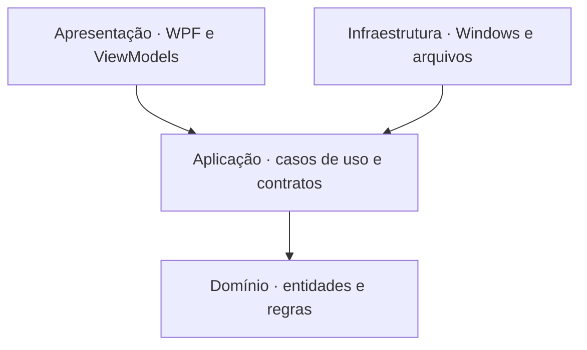

<h1 align="center">
  
  NetStatAnalyzer
</h1>

  Conexões TCP/UDP, portas em escuta e processos do Windows em uma interface desktop.

  <strong><a href="https://github.com/muriloai/NetStatAnalyzer/releases">Baixar para Windows</a></strong>
  · <a href="docs/desenvolvimento.md">Compilar a partir do código</a>

Windows 10 (versão 2004, build 19041 ou posterior) ou Windows 11, em x64. Para usar o pacote portátil autocontido, extraia o ZIP e abra `NetStatAnalyzer.exe`.

## O que você pode consultar

- **Conexões TCP/UDP.** Veja endereços, portas e estados de conexão e identifique o processo pelo PID.
- **Processos.** Consulte a quantidade de conexões, o uso de CPU e as taxas de leitura e escrita por processo.
- **Tarefas agendadas e itens de inicialização.** Veja o que está configurado para rodar automaticamente e confira os comandos e arquivos associados.
- **Triagem local.** Filtre os dados por tag, confiança ou alerta e exporte os registros exibidos em JSON.

A coleta usa amostras do Windows, então conexões muito breves podem passar entre leituras. As taxas de leitura e escrita vêm dos contadores de I/O do processo e podem incluir operações de disco. Os alertas seguem regras locais e servem como pistas para investigação.

## Tecnologias

- **C# e .NET 8** para a aplicação desktop. A interface usa **WPF, XAML e MVVM**.
- **`netstat.exe`, `schtasks.exe`, APIs Win32 e Registro do Windows** para a coleta local.
- **`System.Text.Json`** para configurações, regras de confiança e exportação.
- **xUnit e GitHub Actions** para os testes automatizados no Windows.

## Arquitetura

As setas seguem as dependências principais entre as camadas. A interface chama os casos de uso e os adaptadores de infraestrutura implementam os contratos usados na coleta e na persistência.

## Documentação

- [Guia de uso](docs/uso.md) com filtros, regras de confiança, exportação e atalhos do Windows.
- [Capturas de tela](docs/images/README.md) das quatro abas e do tema claro.
- [Arquitetura e limites da coleta](docs/arquitetura.md) com as fontes de dados do Windows e o fluxo de uma leitura.
- [Compilação, testes e distribuição](docs/desenvolvimento.md).

Licença [MIT](LICENSE).
