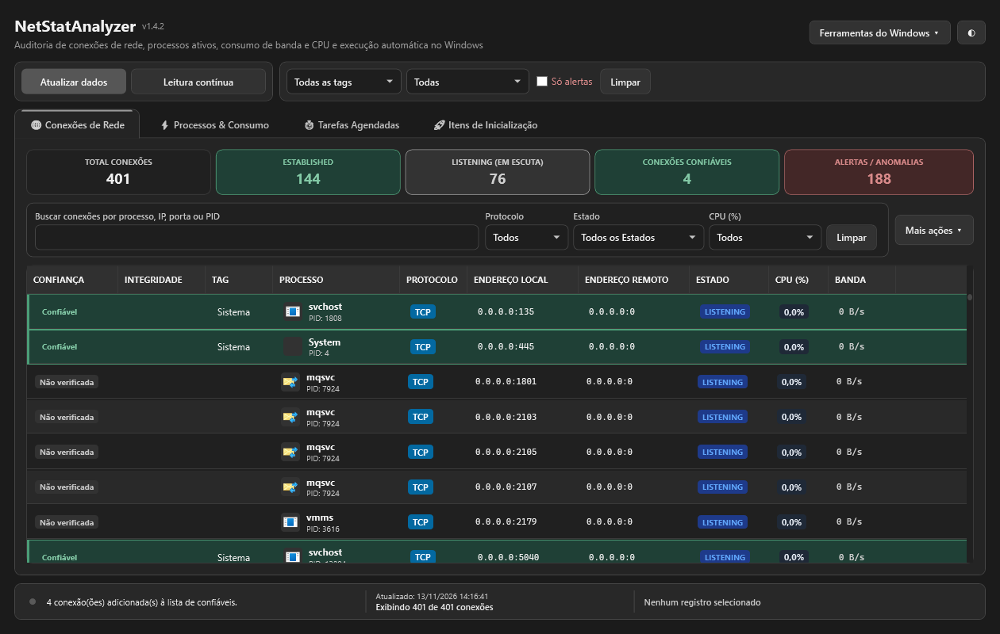
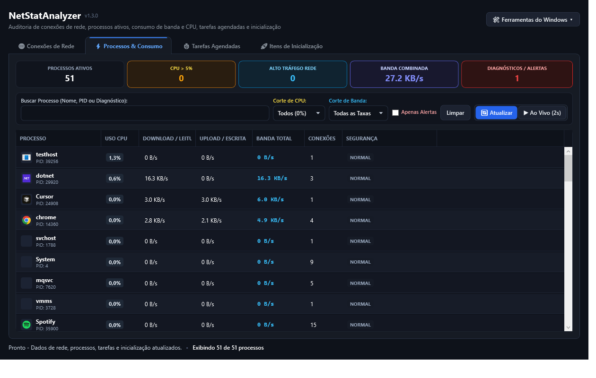
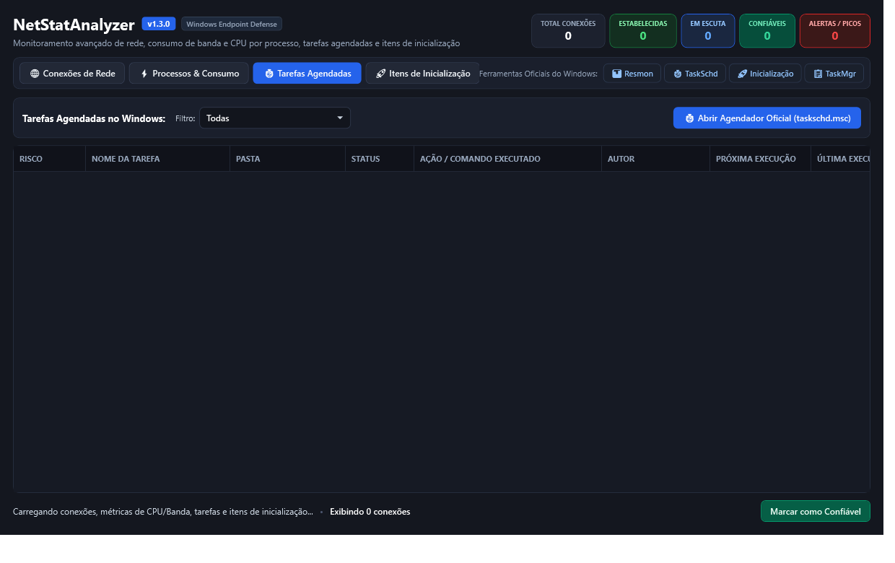
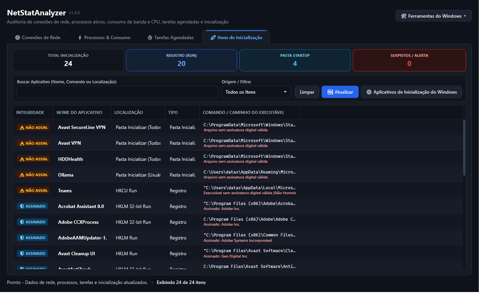
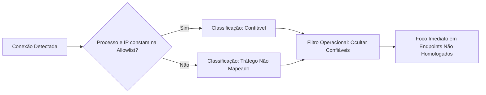

# NetStatAnalyzer

<div align="center">

[](LICENSE)
[](https://dotnet.microsoft.com/download/dotnet/8.0)
[-0078D6?logo=windows&logoColor=white>)](https://microsoft.com/windows)
[](https://github.com/muriloai/NetStatAnalyzer/actions/workflows/tests.yml)
[](https://github.com/muriloai/NetStatAnalyzer/releases)

</div>

<p align="justify">
O <strong>NetStatAnalyzer</strong> é uma solução avançada de <strong>segurança e monitoramento</strong> para <strong>Windows</strong>, projetada para mapear, em tempo real, todas as conexões e portas ativas do seu sistema.

É uma solução voltada à análise de segurança da informação, inclusive em <strong>ambientes corporativos</strong>. Combina inspeção de sockets de rede (TCP/UDP), medição de tráfego e CPU por processo, auditoria da <strong>execução automática no Windows</strong> por tarefas agendadas e itens de inicialização, e detecção de atividades suspeitas como proxies residenciais, mineração não autorizada e scripts em modo oculto.

</p>

<div align="center">



</div>

---

## Escopo e Arquitetura de Integração

O NetStatAnalyzer é otimizado exclusivamente para o sistema operacional Windows | Windows 10 versão 19041+ e Windows 11 x64.

A solução integra-se a APIs e componentes nativos do Windows:

- **Win32 Netstat e IP Helper API**<br>
  Mapeia sockets de rede, portas e endpoints remotos em tempo real.

- **Win32 `GetProcessIoCounters` e `TotalProcessorTime`**<br>
  Consulta contadores de I/O e tempo acumulado de CPU por processo. Taxas e percentuais são derivados por amostragem.

- **Windows Task Scheduler Engine**<br>
  Lista e audita tarefas agendadas nos níveis de usuário e sistema.

- **Windows Registry (`HKCU` e `HKLM` Run/RunOnce) e pastas de inicialização**<br>
  Identifica componentes configurados para inicialização automática, verifica assinaturas digitais e detecta binários órfãos.

- **Integração administrativa nativa**<br>
  Abre ferramentas oficiais do Windows, como `resmon.exe`, `taskschd.msc`, `ms-settings:startupapps`, `taskmgr.exe`, `shell:startup` e `regedit.exe`.

---

## Contexto de Segurança e Conformidade | LGPD e ISO 27001

Relatórios de inteligência de ameaças alertam sobre o risco decorrente de softwares e utilitários não homologados instalados em estações de trabalho. Módulos secundários frequentemente convertem o endpoint corporativo em um ativo compartilhado por terceiros:

1. **Monetização de banda por proxies residenciais**<br>
   Aplicações como `WorldProxyPool`, `PacketStream` e similares podem usar a conexão corporativa para encaminhar tráfego anônimo externo, transformando a máquina em um nó de saída não autorizado.

2. **Mineração e processamento distribuído**<br>
   Utilitários de computação distribuída podem degradar o desempenho do hardware e ampliar o consumo de recursos.

3. **Execução automática oculta**<br>
   Programas e scripts podem ser configurados para executar sem ação manual por tarefas agendadas ou itens de inicialização. Em segurança, manter essa execução é chamado de persistência.

> [!IMPORTANT]
> Sob diretrizes de governança, **LGPD** e controles **ISO 27001**, qualquer estação que opere como roteador de tráfego de terceiros configura violação crítica de rastreabilidade, confidencialidade e controle de ativos. O NetStatAnalyzer centraliza a visibilidade operacional para permitir identificação e resposta imediatas.

---

## Módulos e Recursos

### Controles comuns às quatro abas

- **Atualização de dados:** o botão atualiza as quatro abas. Atualização manual e leitura contínua não rodam ao mesmo tempo; durante a leitura contínua, o indicador verde mostra a atividade e o botão permite pausá-la.
- **Filtros globais:** tag, confiança e alertas atuam em todas as tabelas. A busca e os filtros abaixo das abas afetam somente a tabela ativa.
- **Tags e confiança:** selecione registros em qualquer aba e use o botão direito ou **Mais ações**. Tags são compartilhadas entre as abas e podem ser filtradas globalmente; a confiança também pode ser atribuída a processos, tarefas e itens de inicialização.
  - Escolha uma tag salva ou digite uma nova.
  - Deixe o campo vazio para remover a tag dos itens selecionados.
- **Tema:** o ícone no canto superior direito alterna entre claro e escuro. O tema escuro usa superfícies grafite e realces neutros, preservando cores semânticas para alertas. O claro usa cinzas com botões de alto contraste. A preferência é lembrada em `allowlist.json`.
- **Barra de status:** mantém áreas fixas para estado da leitura, data e quantidade de dados da aba, e resumo dos registros selecionados.
- **Exportação:** cada aba exporta os registros exibidos em JSON, com data da coleta, tag, confiança e os detalhes técnicos disponíveis.

As tags e a confiança dos registros são armazenadas localmente em `allowlist.json`, junto das regras de conexões confiáveis. Registros sem classificação aparecem como **Não verificado**, o que não implica uma ameaça.

---

### Monitoramento de Conexões de Rede

- **Taxa de transferência em tempo real**<br>
  Mede leitura e escrita por socket e processo (`B/s`, `KB/s`, `MB/s`, `GB/s`).

- **Consumo de CPU**<br>
  Exibe indicadores percentuais individuais atualizados em tempo real.

- **CPU (%)**<br>
  O filtro usa o nome da coluna **CPU (%)** e oferece níveis mínimos de `1%`, `5%`, `10%`, `25%` e `50%`. A opção inicial **Todos** não restringe a lista.

- **Filtro de anomalias**<br>
  Isola conexões que apresentem picos ou comportamentos atípicos.

- **Leitura contínua**<br>
  Faz amostragem automática a cada 2 segundos e exibe um indicador visual animado de status.

<div align="center">

</div>

---

### Painel Agregado de Processos

- **Consolidação por processo**<br>
  Agrupa sockets por executável e PID.

- **Volumes de tráfego**<br>
  Separa **Download / Leitura** de **Upload / Escrita**.

- **CPU (%) e BANDA TOTAL**<br>
  Os filtros usam os nomes das colunas **CPU (%)** e **BANDA TOTAL**. Eles oferecem níveis mínimos de CPU (`1%`, `5%`, `10%`, `25%`, `50%`) e de banda (`10 KB/s`, `100 KB/s`, `1 MB/s`, `10 MB/s`). A opção inicial **Todos** não restringe a lista.

- **Conexões ativas**<br>
  Exibe a contagem total por processo.

- **Diagnóstico de integridade**<br>
  Classifica processos como Crítico, Alto Risco, Suspeito, Atenção ou Normal, com detalhes técnicos em tooltips contextuais.

<div align="center">

</div>

---

### Execução Automática no Windows

A área cobre duas formas de execução automática: tarefas que rodam por horário ou evento e itens que iniciam com o Windows ou com a sessão do usuário.

#### Tarefas Agendadas

- **Varredura de tarefas**<br>
  Lista e classifica tarefas agendadas locais.

- **Sinais de execução automática suspeita**<br>
  Identifica scripts PowerShell em modo oculto, intervalos de execução inferiores a 15 minutos, binários em diretórios temporários (`%AppData%`, `%Temp%`) e executáveis sem assinatura digital válida.

- **Acesso ao console de gestão**<br>
  Abre o Agendador de Tarefas nativo (`taskschd.msc`).

<div align="center">

</div>

#### Itens de Inicialização do Sistema

- **Inspeção do Registro**<br>
  Verifica as chaves `HKCU\Software\Microsoft\Windows\CurrentVersion\Run`, `HKLM`, `RunOnce` e os ramos `WOW6432Node`.

- **Pastas de inicialização**<br>
  Mapeia as pastas de inicialização do usuário e do sistema (`shell:startup`).

- **Validação de integridade**<br>
  Alerta sobre arquivos órfãos, cujas entradas apontam para executáveis ausentes, e executáveis de terceiros sem assinatura corporativa.

<div align="center">

</div>

---

## Ferramentas Administrativas Integradas

O NetStatAnalyzer disponibiliza atalhos operacionais para abertura direta dos consoles de diagnóstico oficiais do Windows:

| Ferramenta Oficial               | Comando Nativo            | Finalidade Operacional                                                  |
| :------------------------------- | :------------------------ | :---------------------------------------------------------------------- |
| **Monitor de Recursos**          | `resmon.exe`              | Inspeção aprofundada de sockets, threads e I/O de disco por PID.        |
| **Agendador de Tarefas**         | `taskschd.msc`            | Gerenciamento, desativação ou exclusão de rotinas suspeitas.            |
| **Aplicativos de Inicialização** | `ms-settings:startupapps` | Painel moderno do sistema operacional para habilitar/desabilitar itens. |
| **Gerenciador de Tarefas**       | `taskmgr.exe`             | Finalização de processos e gestão de recursos.                          |
| **Pasta Inicializar**            | `shell:startup`           | Inspeção direta de atalhos e scripts no perfil do usuário.              |
| **Editor do Registro**           | `regedit.exe`             | Inspeção detalhada de chaves Run e políticas de execução.               |

---

## Gestão de Regras de Confiança | Allowlist

Na aba conexões de rede ali, o sistema conta com o mecanismo declarativo de regras de confiança fundamentado no par **Processo + Endereço IP**:



[Navegar por este diagrama](https://dataxstudios.com.br/br/apps/markdown-studio/#c=Zc09TsNAFATgnlPMBXyBFKDEPyISIRHQWS6e1s9hpfWOtbsQJMRhohQcxBdDWRcpaJ6mmO_N4Hgy7xISnl7uAGDdlvT6NV-ISpOaJL10KIp7bL4PgUZjJBTbAwx9TDLCC9bO8eRsTA8_-ckGRYFXO2ZXtqWTGO1gjcy_84UrlPSDnc-f6rpb__m6eQXVf_AW5vOgRy6lnUwqPRebT5lh3TbWpUDsJw1iLL24FfbmwyUJt1EbF1ktKOc656ZtaIjtqL2VROiI2vcTrU9xmX7kSMej9IzdHw&theme=default)

---

## Arquitetura de Software

A solução adota os princípios de **Clean Architecture**, com separação estrita de responsabilidades em camadas e direção de dependências para o núcleo de domínio:

```mermaid
flowchart TD
    subgraph Presentation_Layer [Camada de Apresentação - WPF]
        V[Views: MainWindow e AllowlistManagerWindow]
        VM[ViewModels: MainViewModel, ConnectionItemVM, etc.]
        ROOT[ApplicationCompositionRoot]
    end

    subgraph Application_Layer [Camada de Aplicação]
        UC1[ScanConnectionsUseCase]
        UC2[ScanProcessMetricsUseCase]
        UC3[ScanScheduledTasksUseCase]
        UC4[ScanStartupItemsUseCase]
        UC5[ManageAllowlistUseCase]
        UC6[ExportConnectionsUseCase]
        PORTS[Contratos de Scanners, Repositórios e Ferramentas]
    end

    subgraph Domain_Layer [Camada de Domínio]
        E1[Entidades: NetworkConnection, ProcessMetricInfo, etc.]
        EN[Enumeradores: ThreatLevel, ConnectionState, etc.]
        POL[Políticas: TrustEvaluationPolicy, ThreatDetectionPolicy]
    end

    subgraph Infrastructure_Layer [Camada de Infraestrutura]
        INF1[NetStatCliScanner]
        INF2[Win32ProcessMetricsProvider]
        INF3[WindowsScheduledTaskScanner]
        INF4[WindowsStartupScanner]
        INF5[JsonFileAllowlistRepository]
        INF6[FileConnectionExporter]
    end

    V --> VM
    VM --> UC1 & UC2 & UC3 & UC4 & UC5 & UC6
    UC1 & UC2 & UC3 & UC4 & UC5 & UC6 --> PORTS
    UC1 & UC2 & UC3 & UC4 & UC5 & UC6 --> E1 & EN & POL
    INF1 & INF2 & INF3 & INF4 & INF5 & INF6 -. Implementam .-> PORTS
    ROOT -. Configura .-> INF1 & INF2 & INF3 & INF4 & INF5 & INF6
    ROOT --> UC1 & UC2 & UC3 & UC4 & UC5 & UC6
```



[Navegar por este diagrama](https://dataxstudios.com.br/br/apps/markdown-studio/#c=lZTPbuIwEMbvPMWceoJKlD-HHlaqQpBYNRABpQdrtfImQ7HqeCLbKdvn2cOeetpH4MVWtikh3bTq5mDjzG_G4y-f2UraZzuuLawnHQAAU_140LzcQarRoLLcClLfb_kzamARL3jOIUe4KY_hw-_DL4Ie3KfTb76AezZsI3BvriHhQt0LldMeEG6kpL0UxiZc8QfUIXCWlfi0hHKUx9zTugsRKYWZ62ZmsdgkXUCbXdbZy8VizW7KUorM9xxRUZIR7ueSyAYQVd5pHvMso-2ULuaPWG90F_XZKuOqbsjcGYy4wXPmyjOppgyNSdBqkbVhA4-tsh3mlcR8zc1jGzYMmOXaVqU7fxs0YkHYk84tzJjFP0vS9qPm08VyvWIRKau5JeOEcLsr1KYLS_SqHv5oQQYQpqg1L5wTzHsST6jgokXdCRWHFyXOpI37LFZW5DxHcw1ztHvSj3WrXWjoOVNbeuuCeM5iVRWoeU7aFVnvNHJ7i09ND60st_g2OV3cspTk4cWKjLtcXRkbP3FZeX-kJEX23D2WnKANpcLr9w4_U1vNjdVVZiuN_4rg4-gAW2le9zKbT_tsjtY1Gklx_ACN-BW7F2pw1fRYqulJ5G_IAQt3zTSM1lZzeCKD19qYEftqSE2FrJ12dAXp5wY5Zo6qVQ_eey13EmsDvd4X2CRhkfjVXdSHC3eP_Djw49CPIz-OO8e7-DHla3lD_wcfOyiew4VzROf1a8CFFz1MgzANwzQK0xh6lzArSon-QhRw2djc_UM5IiK1FQ-V5j7-ydJnFT6jzl8&theme=default)

---

## Tecnologias e componentes

| Área                    | Tecnologia presente no projeto                                        | Uso no código                                                                              |
| ----------------------- | --------------------------------------------------------------------- | ------------------------------------------------------------------------------------------ |
| Plataforma              | .NET 8, C# e Windows 10/11 x64                                        | Aplicação desktop e bibliotecas separadas por camada.                                      |
| Interface               | WPF, XAML, data binding e MVVM                                        | Quatro tabelas, filtros, comandos, indicadores e janelas de gestão.                        |
| Arquitetura             | Clean Architecture e injeção manual de dependências                   | Projetos Domain, Application e Infrastructure; composição em `ApplicationCompositionRoot`. |
| Coleta de rede          | `netstat.exe` e `System.Diagnostics.Process`                          | Leitura de conexões TCP/UDP e associação por PID.                                          |
| Métricas                | Win32 `GetProcessIoCounters` por P/Invoke e `TotalProcessorTime`      | Amostras de leitura, escrita e CPU por processo.                                           |
| Execução automática do Windows | `schtasks.exe`, Registro via `Microsoft.Win32` e pastas Startup       | Auditoria de tarefas agendadas e itens de inicialização.                                   |
| Análise de arquivos     | Assinatura Authenticode, informações de versão e caminhos executáveis | Evidências de integridade e identificação de arquivos ausentes.                            |
| Dados locais            | `System.Text.Json`, CSV, TXT e UTF-8                                  | Regras de confiança, tags, tema e relatórios exportados.                                   |
| Qualidade e entrega     | xUnit, coverlet, GitHub Actions e `dotnet publish`                    | Testes automatizados no repositório e distribuição autocontida.                            |

### Exportação para análise

O menu **Mais ações** de cada aba exporta em JSON os itens **exibidos após os filtros globais e locais**. O documento registra a versão, o tipo de dado, a hora da exportação, a hora da última coleta válida e a quantidade de itens.

As abas exportam os seguintes dados por JSON:

- Conexões incluem endereços, PID, tag, confiança, tráfego, CPU e diagnóstico;
- Processos incluem caminho, tag, confiança, CPU, leitura, escrita, conexões e diagnóstico;
- Tarefas incluem horários, comando, autor, tag, confiança, assinatura e arquivo associado;
- Inicialização inclui origem, comando, estado, tag, confiança, assinatura e arquivo associado.

A ausência de uma assinatura ou de uma regra de confiança é uma evidência para investigar, não uma confirmação de ameaça.

> [!WARNING]
> A exportação do JSON inclui caminhos locais, dados de processos, entre outras informações, portanto cuidado ao compartilhá-lo.

---

## Instalação e Execução

### Requisitos de Sistema

- **Plataforma**<br>
  Windows 10 (versão 19041+) ou Windows 11 (64-bit).

- **Ambiente de desenvolvimento**<br>
  [.NET 8.0 SDK](https://dotnet.microsoft.com/download/dotnet/8.0).

### Execução em Modo de Desenvolvimento

```powershell
dotnet run
```

### Release

O comando a seguir gera um executável único e autocontido com o runtime embutido que **não exige instalação prévia do .NET na estação de destino**:

```powershell
dotnet publish NetStatAnalyzer.csproj -c Release -r win-x64 --self-contained true -p:PublishSingleFile=true -p:EnableCompressionInSingleFile=true -p:IncludeNativeLibrariesForSelfExtract=true -o ./publish
```

O binário será gerado em `./publish`.

---

## Testes Automatizados

A base de código conta com **52 testes automatizados** usando xUnit, cobrindo regras de negócio, integridade e políticas de segurança:

- **Políticas de detecção de ameaças (`ThreatDetectionPolicy`)**<br>
  Validam proxies residenciais, rotinas de mineração, scripts PowerShell ocultos e picos anômalos.

- **Cálculo de métricas (`ProcessMetricInfo`)**<br>
  Valida taxas de transferência e formatação proporcional de unidades.

- **Filtros de utilização de CPU**<br>
  Verificam os filtros dinâmicos por CPU no `MainViewModel`.

- **Integridade da Allowlist (`TrustEvaluationPolicy` e `ManageAllowlistUseCase`)**<br>
  Valida a sanitização de endereços IPv4/IPv6, portas e máscaras curinga.

- **Exportação de dados (`FileConnectionExporter`)**<br>
  Valida arquivos nos formatos JSON, CSV e TXT.

Para executar a suíte de testes:

```powershell
dotnet test
```

---

## Estrutura do Projeto

```text
NetStatAnalyzer/
├── assets/                                # Identidade visual e ícones
├── docs/
│   └── images/                            # Evidências visuais para documentação
├── Domain/
│   ├── NetStatAnalyzer.Domain.csproj      # Núcleo isolado sem dependências externas
│   ├── Entities/                          # Entidades de negócio (NetworkConnection, ProcessMetricInfo)
│   ├── Enums/                             # Enumeradores de estado e integridade
│   └── Policies/                          # Regras de ameaça e confiança
├── Application/
│   ├── NetStatAnalyzer.Application.csproj # Casos de uso e portas
│   ├── Contracts/                         # Interfaces de scanners, repositórios e integrações
│   └── UseCases/                          # Implementação dos fluxos de trabalho
├── Infrastructure/
│   ├── NetStatAnalyzer.Infrastructure.csproj # Adaptadores Win32 e implementação de IO
│   ├── Exporting/                         # Exportadores em CSV, TXT e JSON
│   ├── Monitoring/                        # Coleta de métricas via GetProcessIoCounters
│   ├── Persistence/                       # Armazenamento local de regras em JSON
│   └── System/                            # Integrações de Task Scheduler, Registro e Ferramentas
├── Presentation/
│   ├── Styles/DesignSystem.xaml           # Sistema de design, paleta e temas
│   ├── Common/                            # Utilitários MVVM
│   ├── ViewModels/                        # ViewModels e bindings
│   └── Windows/                           # Janelas auxiliares, como o editor de tags
├── NetStatAnalyzer.Tests/                 # Suíte de testes unitários (xUnit)
├── ApplicationCompositionRoot.cs          # Ponto de composição de dependências
├── MainWindow.xaml                        # Janela principal da aplicação
├── MainWindow.xaml.cs                     # Lógica de apresentação da interface
├── AllowlistManagerWindow.xaml            # Janela de gestão de conexões confiáveis
├── NetStatAnalyzer.csproj                 # Projeto principal .NET 8 WPF
└── LICENSE                                # Licença MIT
```

---

## Licença

Este projeto é distribuído sob os termos da licença [MIT](LICENSE).
