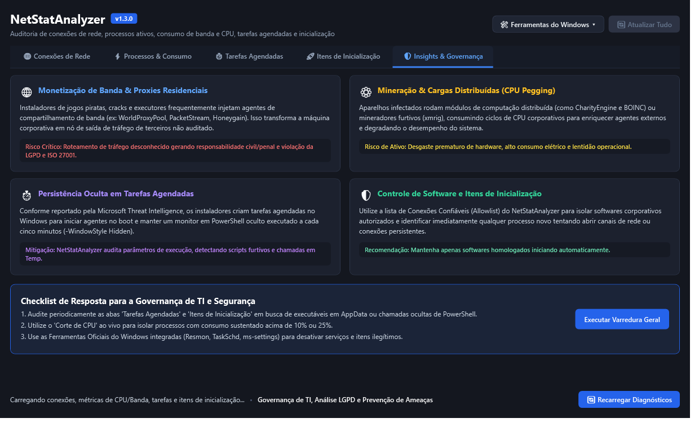
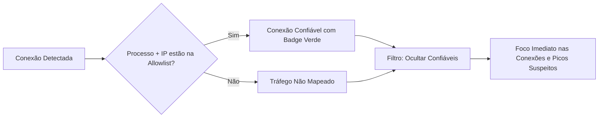

# NetStatAnalyzer

<div align="center">

[](LICENSE)
[](https://dotnet.microsoft.com/download/dotnet/8.0)
[-0078D6?logo=windows&logoColor=white)](https://microsoft.com/windows)
[](https://github.com/muriloai/NetStatAnalyzer/actions/workflows/tests.yml)
[](https://github.com/muriloai/NetStatAnalyzer/releases)
[](#)

</div>

<p align="justify">
<strong>NetStatAnalyzer</strong> é um centro de diagnóstico e monitoramento avançado de segurança para <strong>Windows</strong>. Projetado especificamente para o ecossistema Windows 10 e 11, ele combina inspeção profunda de sockets de rede (TCP/UDP), medição de tráfego de banda (upload/download) e CPU por processo em tempo real, auditoria de persistência (Tarefas Agendadas e Itens de Inicialização) e detecção proativa de ameaças corporativas (como monetizadores de banda residencial, mineradores e scripts ocultos).
</p>

<div align="center">


</div>

---

## 🎯 Alvo e Escopo do Projeto

O **NetStatAnalyzer é 100% focado e otimizado para o sistema operacional Windows** (Windows 10 versão 19041+ e Windows 11 x64).

Ele aproveita subsistemas e recursos nativos do kernel do Windows:
- **Win32 Netstat & IP Helper API:** Mapeamento de sockets de rede e endpoints remotos.
- **Win32 `GetProcessIoCounters` & `TotalProcessorTime`:** Medição precisa de consumo de I/O de rede (leitura/escrita) e porcentagem de CPU.
- **Windows Task Scheduler CLI & Engine:** Auditoria detalhada de tarefas agendadas em nível de sistema e usuário.
- **Windows Registry (`HKCU` & `HKLM` Run/RunOnce):** Varredura de programas configurados para iniciar com o Windows.
- **Atalhos com 1 Clique para Ferramentas Administrativas Oficiais do Windows:** Acesso imediato ao Monitor de Recursos (`resmon.exe`), Agendador de Tarefas (`taskschd.msc`), Configurações de Inicialização (`ms-settings:startupapps`), Gerenciador de Tarefas (`taskmgr.exe`), Pasta Inicializar (`shell:startup`) e Editor do Registro (`regedit.exe`).

---

## 🛡️ Contexto Estratégico: Riscos Corporativos, LGPD e ISO 27001

Relatórios recentes de inteligência de ameaças (como os detalhados pela *Microsoft Threat Intelligence*) alertam sobre o perigo de instaladores não homologados (jogos piratas, ativadores, cracks, utilitários de driver e executores de scripts). Em vez de simples utilitários, esses instaladores entregam módulos em paralelo que convertem a estação de trabalho em ativo de monetização de terceiros:

1. **Monetização de Banda (Residential Proxies):** Utilitários como `WorldProxyPool`, `PacketStream` e `Honeygain` compartilham silenciosamente a conexão de internet corporativa, transformando o endpoint da empresa em nó de saída de tráfego anônimo de terceiros.
2. **Mineração e Computação Distribuída:** Ferramentas como `CharityEngine`, `BOINC` ou mineradores furtivos (`xmrig`) consomem a CPU corporativa, degradando o desempenho e sobrecarregando a infraestrutura.
3. **Persistência Furtiva:** Agentes configurados para iniciar no boot do Windows e monitores ocultos executados via PowerShell a cada 5 minutos (`-WindowStyle Hidden`).

> ⚠️ **Impacto Corporativo:** Em conformidade com a **LGPD** e **ISO 27001**, um endpoint que roteia tráfego desconhecido representa falha crítica de rastreabilidade, controle de ativos e segurança da informação. O NetStatAnalyzer fornece a visibilidade estratégica necessária para mitigar esses riscos imediatamente.

---

## ⚡ Principais Recursos da Versão 1.3.0

### 1. 🌐 Monitoramento de Conexões e Tráfego em Tempo Real
- **Banda e Taxa de Transferência:** Exibição da taxa de rede por processo em formato dinâmico (`B/s`, `KB/s`, `MB/s`, `GB/s`).
- **Medição de CPU (%):** Badges coloridos indicando o consumo individual de cada processo ativo.
- **Filtro de Corte de CPU ao Vivo:** Slider/seletor instantâneo para filtrar conexões e exibir **somente processos que ultrapassem X% de CPU** (ex: `> 1%`, `> 5%`, `> 10%`, `> 25%`, `> 50%`).
- **Filtro Rápido de Anomalias:** Checkbox para isolar de imediato processos com alertas de risco ou picos anormais de tráfego.

<div align="center">

</div>

---

### 2. ⚡ Visão Consolidada de Processos e Consumo
- Agrupamento inteligente por executável e PID.
- Detalhamento de **Download / Leitura** e **Upload / Escrita**.
- Contagem de conexões ativas simultâneas.
- Diagnóstico automático com flags de alerta (🚨 *Proxy Residencial*, 🚨 *Mineração Oculta*, ⚠️ *Pico de Tráfego*).

<div align="center">

</div>

---

### 3. ⏱️ Auditoria de Tarefas Agendadas (Windows Task Scheduler)
- Listagem completa das tarefas agendadas locais.
- **Detecção de Persistência Furtiva:** Identifica scripts em execução oculta de PowerShell (`-WindowStyle Hidden`, `-enc`), disparos frequentes (a cada 5 minutos), executáveis rodando a partir de pastas temporárias (`%Temp%` ou `AppData`) e tarefas não-Microsoft.
- Botão direto para **Abrir o Agendador de Tarefas Oficial (`taskschd.msc`)** para desativar ou remover entradas suspeitas.

<div align="center">

</div>

---

### 4. 🚀 Auditoria de Itens de Inicialização (Startup Items)
- Varredura de chaves de registro `HKCU\Run`, `HKCU\RunOnce`, `HKLM\Run`, `HKLM\RunOnce` e `WOW6432Node`.
- Inspeção das pastas `shell:startup` (Usuário) e `Common Startup` (Todos os Usuários).
- Detecção de scripts `.vbs`, `.bat`, `.cmd` e executáveis em locais não homologados.
- Links rápidos para abrir:
  - **Configurações do Windows (`ms-settings:startupapps`)** para ativar/desativar programas na inicialização.
  - **Gerenciador de Tarefas (`taskmgr.exe`)**.
  - **Pasta Inicializar (`shell:startup`)** no Windows Explorer.
  - **Editor do Registro (`regedit.exe`)**.

<div align="center">

</div>

---

### 5. 🛡️ Central de Insights de Ameaças & Painel Estratégico
- Cartões explicativos com contadores de ameaças detectadas no endpoint.
- Checklist de resposta e orientações para governança de TI.

<div align="center">

</div>

---

## 🛠️ Ferramentas Oficiais do Windows Integradas

O NetStatAnalyzer inclui links diretos para que o administrador ou usuário abra as ferramentas oficiais de remediação do Windows com um único clique:

| Ferramenta Oficial | Comando Nativo | Finalidade |
| :--- | :--- | :--- |
| **Monitor de Recursos** | `resmon.exe` | Visualização aprofundada de I/O de rede e threads por processo. |
| **Agendador de Tarefas** | `taskschd.msc` | Gerenciamento, desativação e exclusão de tarefas agendadas suspeitas. |
| **Aplicativos de Inicialização** | `ms-settings:startupapps` | Interface oficial moderna do Windows para desativar itens de inicialização. |
| **Gerenciador de Tarefas** | `taskmgr.exe` | Finalização de processos persistentes e visualização da aba Inicializar. |
| **Pasta Inicializar** | `shell:startup` | Acesso à pasta de inicialização do perfil de usuário no Windows Explorer. |
| **Editor do Registro** | `regedit.exe` | Inspeção direta das chaves Run e RunOnce do Windows. |

---

## 🔒 Sistema de Conexões Confiáveis (Allowlist)

O NetStatAnalyzer permite cadastrar regras de tráfego homologado com base na tupla **Processo + Endereço IP**:



---

## 🏗️ Arquitetura do Software

O projeto segue os princípios de **Clean Architecture**, dividindo responsabilidades em camadas desacopladas e testáveis:

```mermaid
flowchart TD
    subgraph Presentation_Layer [Apresentação: WPF e MVVM]
        V[Views: MainWindow e AllowlistManagerWindow]
        VM[ViewModels: MainViewModel, ConnectionItemVM, ScheduledTaskVM, StartupItemVM]
        CMD[AsyncRelayCommand e Data Binding]
    end

    subgraph Application_Layer [Aplicação: Casos de Uso e Contratos]
        UC1[ScanConnectionsUseCase]
        UC2[ScanProcessMetricsUseCase]
        UC3[ScanScheduledTasksUseCase]
        UC4[ScanStartupItemsUseCase]
        UC5[ManageAllowlistUseCase]
        UC6[ExportConnectionsUseCase]
        PORTS[Portas: INetworkScanner, IProcessResolver, IProcessMetricsProvider, IScheduledTaskScanner, IStartupItemScanner]
    end

    subgraph Domain_Layer [Domínio: Entidades e Políticas]
        E1[NetworkConnection, ProcessMetricInfo, ScheduledTaskItem, StartupItem]
        EN[Enums: NetworkProtocol, ConnectionState, ThreatLevel]
        POL[TrustEvaluationPolicy e ThreatDetectionPolicy]
    end

    subgraph Infrastructure_Layer [Infraestrutura: Adaptadores Win32 e Sistema]
        INF1[NetStatCliScanner]
        INF2[Win32ProcessResolver]
        INF3[Win32ProcessMetricsProvider via GetProcessIoCounters]
        INF4[WindowsScheduledTaskScanner via schtasks]
        INF5[WindowsStartupScanner via Registry e Pastas]
        INF6[WindowsToolsLauncher]
        INF7[JsonFileAllowlistRepository]
        INF8[FileConnectionExporter]
    end

    V --> VM
    VM --> UC1 & UC2 & UC3 & UC4 & UC5 & UC6
    UC1 & UC2 & UC3 & UC4 & UC5 & UC6 --> PORTS
    UC1 & UC2 & UC3 & UC4 & UC5 & UC6 --> E1 & EN & POL
    INF1 & INF2 & INF3 & INF4 & INF5 & INF6 & INF7 & INF8 -. Implementam .-> PORTS
```



---

## 💻 Como Compilar e Executar

### Pré-requisitos
- **Sistema Operacional:** Windows 10 (versão 19041+) ou Windows 11 (64-bit).
- **SDK:** [.NET 8.0 SDK](https://dotnet.microsoft.com/download/dotnet/8.0) instalado.

### 1. Executar em Desenvolvimento
```powershell
dotnet run
```

### 2. Gerar o Executável Portátil (`.exe`)
Gera um executável único com o runtime do .NET 8 embutido e comprimido (**não necessita de .NET instalado na máquina de destino**):
```powershell
dotnet publish NetStatAnalyzer.csproj -c Release -r win-x64 --self-contained true -p:PublishSingleFile=true -p:EnableCompressionInSingleFile=true -p:IncludeNativeLibrariesForSelfExtract=true -o ./publish
```
> O executável estará pronto em: `./publish/NetStatAnalyzer.exe`

---

## 🧪 Testes Automatizados

A aplicação conta com **44 testes automatizados** utilizando xUnit cobrindo:
- **Políticas de Detecção de Ameaças (`ThreatDetectionPolicy`):** Detecção de proxy residencial (`WorldProxyPool`), mineração oculta (`CharityEngine`, `BOINC`), monitores PowerShell ocultos, picos de banda e scripts de inicialização.
- **Formatação de Métricas (`ProcessMetricInfo`):** Formatação consistente de taxas (`B/s`, `KB/s`, `MB/s`, `GB/s`).
- **Filtro de Corte de CPU ao Vivo:** Validação de corte dinâmico no `MainViewModel`.
- **Conexões Confiáveis (`TrustEvaluationPolicy` & `ManageAllowlistUseCase`):** Sanitização de endereços IPv4/IPv6, portas e wildcards.
- **Exportadores (`FileConnectionExporter`):** Formatação de arquivos JSON, CSV e TXT.
- **Geração de Evidências Visuais (`ScreenshotGeneratorTests`):** Renderização e captura automatizada das telas.

Execute os testes com:
```powershell
dotnet test
```

---

## 📁 Estrutura de Pastas

```text
NetStatAnalyzer/
├── assets/                                # Ícones da aplicação
├── docs/
│   └── images/                            # Imagens e capturas de tela para documentação
├── Domain/
│   ├── Entities/                          # Modelos de domínio (NetworkConnection, ScheduledTaskItem, etc.)
│   ├── Enums/                             # Enums (ThreatLevel, ConnectionState, etc.)
│   └── Policies/                          # Políticas de confiança e detecção de ameaças
├── Application/
│   ├── Contracts/                         # Interfaces de repositórios, scanners e provedores
│   └── UseCases/                          # Casos de uso de varredura, métricas e persistência
├── Infrastructure/
│   ├── Exporting/                         # Exportadores CSV, TXT e JSON
│   ├── Monitoring/                        # Provedor de métricas Win32 (CPU e IO Counters)
│   ├── Persistence/                       # Repositório de regras de confiança
│   ├── Processes/                         # Resolução de executáveis e caminhos Win32
│   ├── Scanning/                          # Varredura de sockets netstat
│   └── System/                            # Varredura de tarefas, startup e launcher de ferramentas
├── Presentation/
│   ├── Common/                            # Base MVVM e comandos
│   ├── Extensions/                        # Extensões de UI
│   ├── Services/                          # Cache de ícones de processos
│   └── ViewModels/                        # ViewModels das janelas e abas
├── NetStatAnalyzer.Tests/                 # Bateria de testes unitários automatizados (xUnit)
├── MainWindow.xaml                        # Interface da janela principal
├── MainWindow.xaml.cs                     # Lógica de apresentação da janela principal
├── AllowlistManagerWindow.xaml            # Janela de gerenciamento de regras confiáveis
├── NetStatAnalyzer.csproj                 # Projeto .NET 8 WPF
└── LICENSE                                # Licença MIT
```

---

## 📄 Licença

Distribuído sob os termos da licença [MIT](LICENSE).
