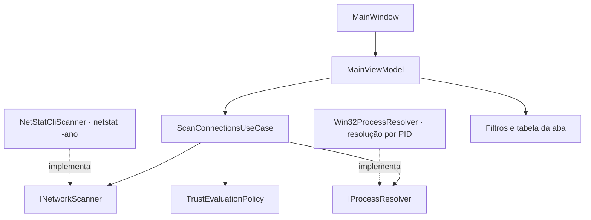

# Arquitetura do NetStatAnalyzer

[Voltar ao projeto](../README.md) · [Compilação e testes](desenvolvimento.md)

O projeto usa uma separação em camadas inspirada em Clean Architecture. [ApplicationCompositionRoot](../ApplicationCompositionRoot.cs) cria os adaptadores do Windows, injeta as dependências nos casos de uso e monta a janela principal.

## Onde começar no código

| Camada | Responsabilidade | Pontos de entrada |
| --- | --- | --- |
| Apresentação | Janela WPF, data binding, filtros e comandos das abas. | [MainWindow.xaml](../MainWindow.xaml), [MainViewModel](../Presentation/ViewModels/MainViewModel.cs) |
| Aplicação | Coordena a coleta, associa processos a conexões e oferece operações sobre regras e anotações. | [Casos de uso](../Application/UseCases), [Contratos](../Application/Contracts) |
| Domínio | Modela conexões e regras de confiança e avalia os sinais usados nos alertas. | [Entidades](../Domain/Entities), [Políticas](../Domain/Policies) |
| Infraestrutura | Consulta o Windows, lê metadados de arquivos e grava os arquivos locais. | [Coletores](../Infrastructure/Scanning), [Integrações com o Windows](../Infrastructure/System), [Persistência](../Infrastructure/Persistence), [Exportação](../Infrastructure/Exporting) |

## Fluxo de uma leitura de conexões

## Fontes e limites da coleta

| Dados | Fonte | Limite de interpretação |
| --- | --- | --- |
| Conexões | `netstat -ano` e associação de PID via `System.Diagnostics.Process`. | Cada leitura é uma amostra da máquina local. O aplicativo trabalha com os dados listados pelo Windows, sem inspecionar o conteúdo dos pacotes. |
| CPU e I/O | `TotalProcessorTime` e `GetProcessIoCounters` via P/Invoke. As taxas vêm da diferença entre amostras do mesmo processo. | O I/O inclui operações de arquivos, rede e dispositivos. As taxas não isolam download e upload nem medem o tráfego de um socket. As permissões podem limitar quais métricas e caminhos estão disponíveis. |
| Tarefas agendadas | `schtasks.exe` e inspeção do comando e do arquivo associado, quando acessíveis. | A coleta depende do que o Windows disponibiliza ao usuário. Indicadores como execução oculta e repetição frequente servem para orientar a revisão. |
| Inicialização | Chaves `Run` e `RunOnce` em `HKCU` e `HKLM`, a chave `Run` de 32 bits em `HKLM\Software\WOW6432Node` e as pastas Inicializar do usuário e de todos os usuários. | A aba cobre essas origens. Entradas que apontam para arquivos ausentes ou sem dados de assinatura podem merecer revisão. |
| Serviços | Win32 SCM API (`EnumServicesStatusExW`) e Registro (`HKLM\SYSTEM\CurrentControlSet\Services`). Controle in-process com fallback agrupado em PowerShell elevado (`runas`). | A listagem e leitura de status não exigem elevação. O controle direto de serviços do sistema solicita elevação UAC em lote único apenas quando necessário. |
| Arquivos | Caminho, informações de versão, dados da assinatura Authenticode incorporada e SHA-256 quando usado em uma regra ou anotação de confiança. | As informações de assinatura exibidas não equivalem à validação da cadeia de certificados. O hash permite comparar o arquivo com a cópia marcada como confiável. |

As regras de confiança só alteram a classificação local. O aplicativo não bloqueia conexões. As heurísticas usam dados disponíveis na estação, como nomes, caminhos e comandos, e podem gerar falsos positivos.
