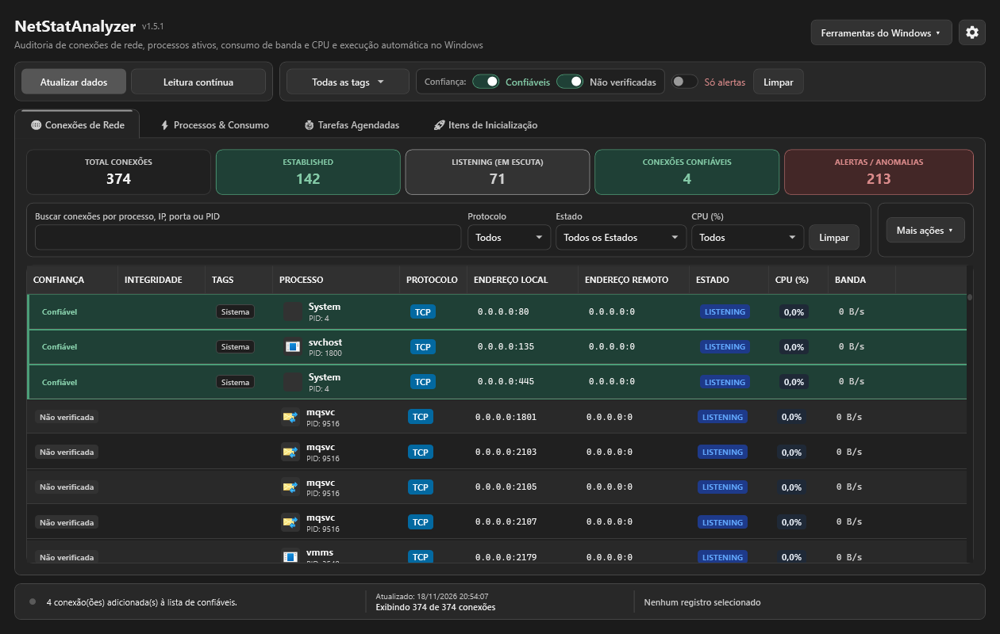
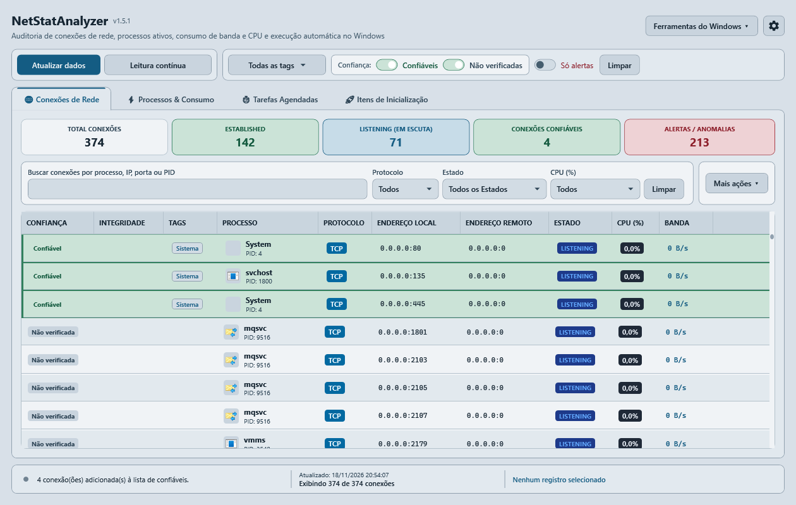
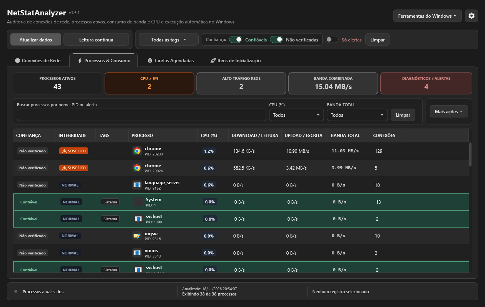
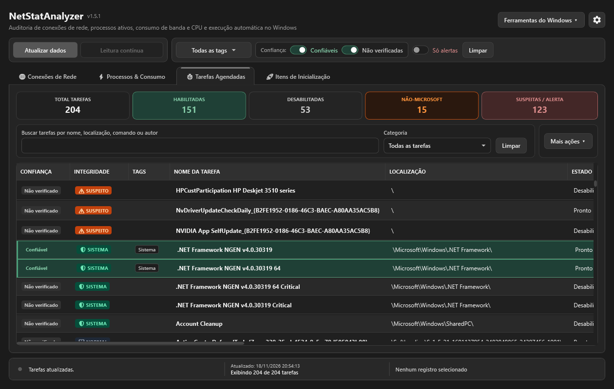
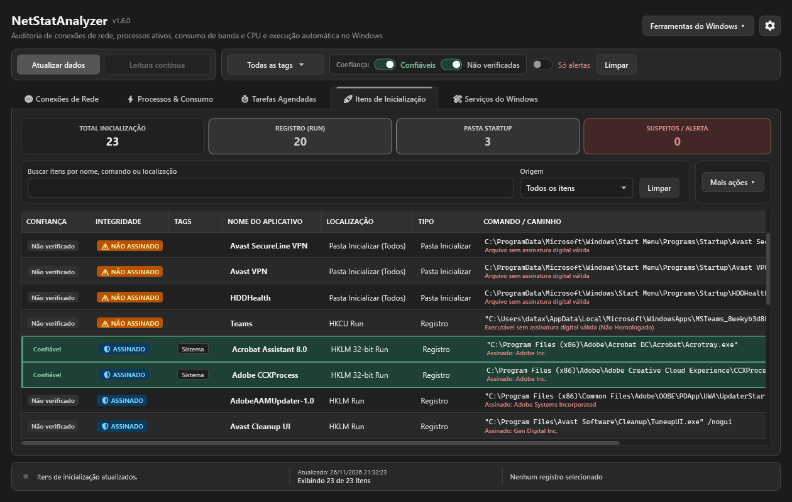

# Capturas de tela do NetStatAnalyzer

[Voltar ao projeto](../../README.md) · [Guia de uso](../uso.md)

## Conexões de rede

## Processos e consumo

## Tarefas agendadas

## Itens de inicialização

